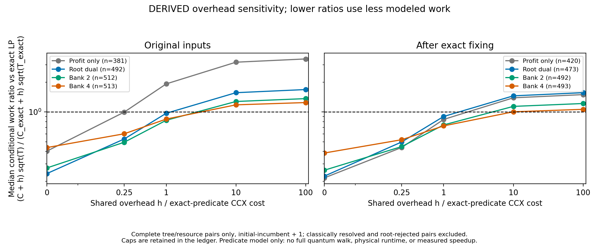

# Reversible pruning study: results and manuscript fit

Completed 24 October 2026 (Asia/Calcutta). Experiments and the locally predeclared protocol began 23 October; no external preregistration is claimed. The restored LaTeX source, bibliography and PDF have not been edited in this research phase.

## Finding and contribution boundary

The completed study supports a concrete construction/resource result: exact reversible fractional-LP pruning, a cheaper safe root-dual predicate and nested small multiplier banks occupy different pruning/circuit-cost regimes. The lower-cost predicate can lose its modeled benefit when shared walk overhead becomes large. Compact arithmetic trades workspace for gates and depth. These negative regimes are central findings, not exceptions to hide.

The broad idea of LP-pruned quantum knapsack branch-and-bound is **already in Wilkening et al. (2025), Supplementary F.2**. Generic heuristic cost versus pruning is already discussed by Martiel and Remaud. Weak duality, reduced-cost counting and rational cross multiplication are known. The defensible candidate contribution is the explicit clean predicate portfolio, matched arithmetic/dispatch controls, scoped verification and same-input resource/pruning evidence. Global historical priority remains UNRESOLVED. Do not claim first LP-QBnB, a new duality theorem, quantum advantage or guaranteed QIP acceptance.

Closest-source comparison: [Wilkening supplement audit](WILKENING_SUPPLEMENT_OVERLAP.md), based on the [published primary article](https://doi.org/10.1038/s41534-025-01097-8) and Supplementary F.2. The predecessor already estimates QBnB resources; our distinction cannot merely be estimating gates from classical trees. Its favorable benchmark assumptions and differing gate model must be acknowledged. [Martiel–Remaud primary preprint](https://arxiv.org/abs/1908.11291), Sections 3–4, is a further explicit boundary. [Dey–Dubey–Molinaro](https://arxiv.org/abs/2007.15192), Section 3 and Theorem 3, supplies reduced-cost/tree-counting precedent with algorithm/distribution assumptions that are not imported here.

## Experimental scope

The panels contain 700 original inputs (five classes, seven sizes n=12..24, twenty recorded seeds), their 700 exact reduced cores, 45 independent R=1,000,000 inputs (n=20,24,28), and 15 uniformly scaled encoding controls. The cores and scaling controls are paired transformations, not additional independent random instances. Full arrays, seeds and source hashes are saved.

All six single-scan families were compiled on the 700 original inputs and all 700 cores. For 389 unchanged cores the identical arrays/capacity reuse original resource records through an independently checked alias ledger; 311 changed cores were compiled separately. Two expensive depth-wrapper controls were compiled on the preselected 105 original and corresponding 105 core inputs. Independent stress and scaling panels use separate ledgers.

The six final resource runs contain **6,732 build attempts: 6,696 completed and 36 qubit-budget caps** (DERIVED resources, MEASURED build outcomes). All caps are fixed-point single scans: 33/45 independent high-bit cases and 3/15 scaling controls. They exceed this construction's 150,000-wire budget; this is not proof of an unavoidable lower bound. The earlier 80-build pilot is separately retained and excluded from that total.

Static threshold trees have a 50,000-node cap. All 183 initially time-capped fixed conditions were rerun at the same node cap with five seconds: 23 completed, 160 node-capped, 0 conflicts, 0 remaining time caps. Raw initial records are unchanged. Final tree comparisons use that explicit overlay; optimizer completion statuses retain their initial diagnostic budgets. Complete-case ratios are conditional on completion and do not describe every hard/capped instance.

## Correctness evidence

| Check | Recorded scope | Outcome and classification |
|---|---|---|
| Broad circuit validation | 128 exhaustive tiny method-cases plus 32 sampled larger method-cases; 422,144 columns | 0 predicate mismatches, 0 dirty columns (SIMULATED) |
| Independent production reference | Fifteen adversarial inputs, seven families; 24,432 columns per family | 0 mismatches, 0 dirty columns, 0 unsafe prunes per family (SIMULATED) |
| All-700 circuit audit | Exact single scan, fixed-point single scan and root dual; 534,882 columns per family | 0 mismatches, 0 dirty columns, 0 unsafe prunes per family (SIMULATED) |
| Exact-fixing audit | 6,664 tiny/adversarial/random inputs, 19,685 opposite-LP checks, 28,931 threshold-set bijections | 0 failures (MEASURED classical checks; exact references DERIVED) |
| Compact arithmetic | 5,456 primitive columns; 128 predicate method-cases, 2,645,200 columns | 0 mismatches, 0 dirty predicate columns (SIMULATED) |
| Independent compact checks | Separate scalar interpreter, four matching families, 34 fixed-depth cases per family, 7,012 columns per family | 0 predicate mismatches, 0 dirty columns per family (SIMULATED) |
| Independent dense checks | Nonempty 15-qubit/16-amplitude and separate 22-qubit/32-amplitude compact examples | 0 amplitude error in each stated case; larger skips retained (SIMULATED) |

These checks overlap in inputs and are not independent statistical samples. The all-700 audit covers every depth encoding and both target bits with recorded selected prefixes/thresholds; it is **not exhaustive over all assignments and thresholds**. Exact X/CX/CCX permutation-column propagation executes every gate with zero-initialized workspace. Dense Qiskit tests are separately bounded. No dense simulation of thousands of workspace qubits is claimed.

Exact fixing reduced 311/700 instances and left 11 empty cores. Every original optimum equaled fixed-in profit plus exact core optimum. Every completed core optimizer witness was reconstructed and checked against original capacity, objective and fixed assignments: 0 failures. The initial pipeline needed no detection calls on 26/700 originals and 46/700 cores; these include the 11 empty cores. Component circuit counts on those inputs are diagnostic costs of a function, not QPU work that the optimizer must perform.

Derivations preceded implementation. The precision condition is sufficient, not an instancewise iff requirement. That requested iff formulation has a counterexample and is rejected in [scope and rejected claims](SCOPE_AND_REJECTED_CLAIMS.md). Exact cross products need no truncation and no quantum division of unknown data; the fixed-point baseline already compiled efficiencies classically, so do not claim to remove a variable divider from it.

## Matched logical circuit costs

The table gives medians of per-instance CCX ratios, all DERIVED from explicit gate lists. Below 1 favors the numerator. Gates, depth, workspace and CCX are separate coordinates; no ratio is physical runtime. Full vectors and class/size breakdowns are in `paired_summary.json` and `paired_resource_rows.csv`.

| Numerator / denominator | Original median (pairs) | Core median (pairs) |
|---|---:|---:|
| root_dual/exact_single | 0.142 (700) | 0.141 (700) |
| bank2/exact_single | 0.196 (700) | 0.196 (700) |
| bank4/exact_single | 0.321 (700) | 0.316 (700) |
| exact_single/fixedpoint_single | 0.546 (700) | 0.552 (700) |
| exact_single/exact_wrapper | 0.059 (105) | 0.079 (105) |
| exact_wrapper/fixedpoint_wrapper | 0.933 (105) | 0.892 (105) |

Important unfavorable results remain: exact wrappers use more CCX than fixed-point wrappers on 22/105 original cases and 18/105 cores. Exact single scan loses to fixed-point single scan on one core (11 empty cores tie). The large single-scan versus wrapper difference is a dispatch/architecture effect; it must not be attributed entirely to arithmetic or advertised as a new theorem.

The separate matched fixed-depth compact control uses simple Cuccaro MAJ/UMA arithmetic ([primary source](https://arxiv.org/abs/quant-ph/0410184), Sections 2 and 4.3). On the uncorrelated n=12, seed=12000, depth=6 input, root dual changes from 540 logical qubits / 404 CCX / depth 215 to 65 / 989 / 2466; exact LP changes from 3540 / 2636 / 1003 to 132 / 9287 / 23132 (DERIVED). Root dual remains cheaper within both compilers on all five n=12 pilot classes, but this compact result is not generalized to all 700 inputs. [Complete compact report](COMPACT_ARITHMETIC_SENSITIVITY.md).

## Pruning versus shared overhead

Use the explicitly conditional model R(h)=(C_weak+h)*sqrt(T_weak)/((C_exact+h)*sqrt(T_exact)). T is a MEASURED classical static tree size, C is a DERIVED predicate CCX count, and h is HARDCODED sensitivity, not an implemented walk. Ratios are DERIVED. At h=0 the model omits shared acceptance, branching and reflection costs; it cannot establish end-to-end acceleration. Known-T assumptions and certificate computation are not free.

For the root-dual versus exact-LP comparison at the initial-incumbent+1 threshold, exclude root-rejected conditions and cases resolved classically without detection. Keep all capped conditions in the ledger and report only complete paired ratios:

| Panel | Complete pairs | Median R(0) | Median R(C_exact) | Median R(10 C_exact) |
|---|---:|---:|---:|---:|
| main700 | 492 | 0.238 | 0.971 | 1.567 |
| core700 | 473 | 0.225 | 0.901 | 1.457 |

This reversal is a useful scientific result: cheap weaker bounds can help a predicate-dominated model and lose when shared overhead dominates. Small banks provide intermediate choices, not a universal winner. The curve is algebra applied to observed resources and trees; there is no fitted validation of square-root scaling or measured quantum speedup.

## Complete/capped tree ledger

Each panel has two conditions per input (initial-incumbent+1 and answer-known optimum+1 diagnostic). These conditions are dependent and are summarized separately in proxy tables. Counts below are MEASURED classical enumeration after time-cap overlays; incomplete counts are processed-node lower bounds, not full T.

| Panel | Method | Complete fixed trees / conditions | Node-capped conditions | Completed structural optimizers / inputs |
|---|---|---:|---:|---:|
| main700 | simple | 790/1400 | 610 | 407/700 |
| main700 | root_dual | 1216/1400 | 184 | 638/700 |
| main700 | bank2 | 1238/1400 | 162 | 692/700 |
| main700 | bank4 | 1239/1400 | 161 | 697/700 |
| main700 | exact_lp | 1246/1400 | 154 | 698/700 |
| core700 | simple | 912/1400 | 488 | 487/700 |
| core700 | root_dual | 1217/1400 | 183 | 638/700 |
| core700 | bank2 | 1238/1400 | 162 | 692/700 |
| core700 | bank4 | 1239/1400 | 161 | 697/700 |
| core700 | exact_lp | 1246/1400 | 154 | 698/700 |
| independent_large | simple | 16/90 | 74 | 3/45 |
| independent_large | root_dual | 67/90 | 23 | 27/45 |
| independent_large | bank2 | 68/90 | 22 | 29/45 |
| independent_large | bank4 | 69/90 | 21 | 29/45 |
| independent_large | exact_lp | 71/90 | 19 | 31/45 |

All completed structural optimizers returned correct optimum values and valid witnesses (0 mismatches); failures/caps are retained. These optimizer completion rates are budget-dependent classical accounting, not quantum timing or a comparison against COMBO. The chosen static trees mark full assignments only. Strong classical BnB can exploit integral LP completions, adaptive ordering and other termination rules, so these are not optimal classical search trees.

Certificates provide separate valid upper bounds. `certificate_bank_controls.jsonl` records the minimum of member certificates for banks, all member computations and host times; it is not exact intersection counting. The observed-T proxy is separate from certificate-based scheduled detection scales. Uniform scaling normalizes to identical arrays in 15/15 controls (0 mismatches, DERIVED), so those results cannot establish intrinsically hard high-bit performance.

## How this fits the preserved paper

The strongest coherent direction is a paper about **explicit reversible bound portfolios and their resource/pruning regimes**, building on existing quantum knapsack tree search. A quantum-game-theory pivot would require a new model, baselines and claims, and is not supported by this study. IBM execution remains optional corroboration; none is claimed or required to make these offline results real.

The existing 777-line audit remains the edit map. Preserve the broad introduction and legitimate bibliography, correct individual erroneous reference identifiers, and add the closest LP-QBnB/implementation sources. Replace unsupported oracle-resource assertions in lines 257–281 with the construction and matched controls. Repair the detector/witness/known-bound assumptions in lines 184–195 and 249–375. Replace circular scheduled-query evidence and unsupported performance claims in lines 568–653 with the scoped paired results. Keep spectral quantities distinct and archived hardware claims pending their own provenance reconciliation. Rewrite the abstract/conclusion only to match the supported results. The detailed [independent paper-fit map](independent_review.md) identifies further local edits.

This research supplies credible additional material; it does not make the restored paper submission-ready automatically. Full walk synthesis, physical runtime estimates, broad historical priority and existing manuscript issues remain outside the completed predicate-study claim. QIP desk rejection or acceptance cannot be guaranteed.

## Reproduction and evidence

`PROTOCOL.md` records sampling, controls and caps. `paired_summary.json` pins inputs, raw results, aliases, analysis source and dependency manifests. All initial attempts, capped builds and v1/v2 core pairing attempts remain saved; only explicitly named final files and overlays enter the primary analysis. Old experimental data were not manually edited.

Regenerate derived summaries: `python research_log/pruning_study_20261023/analyze_paired.py`, then `make_figures.py` and `write_report.py` at the same path. Build and structural drivers have recorded manifests and resumable outputs. New circuit/tree sources are under `simulation/pruning_study_20261023/`. Independent verification is documented in `reviewer_followup_results.md` and `FINAL_AGGREGATION_REVIEW.md`. This report's numerical tables are generated from the final paired summary, not transcribed favorable selections.
